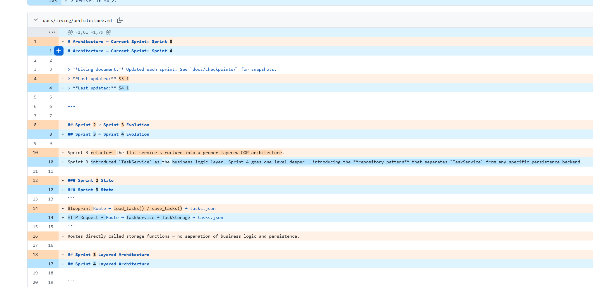
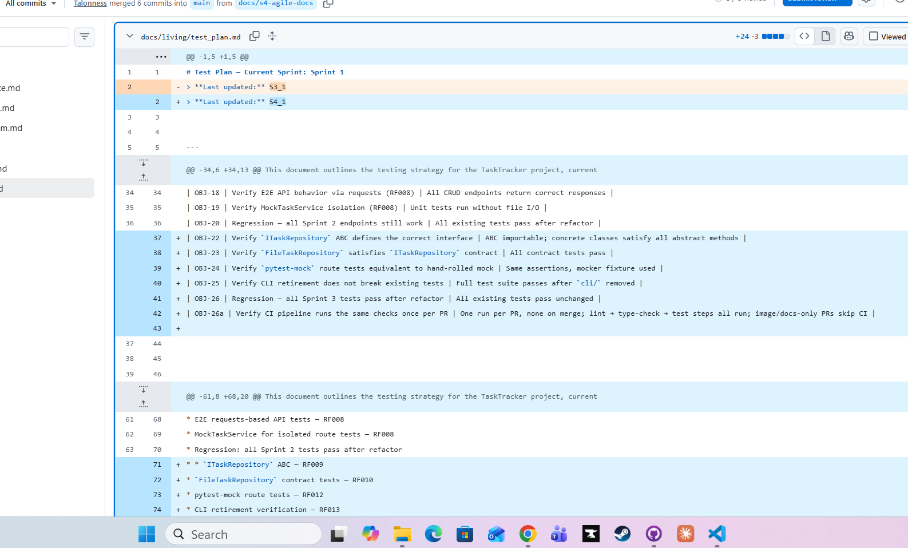
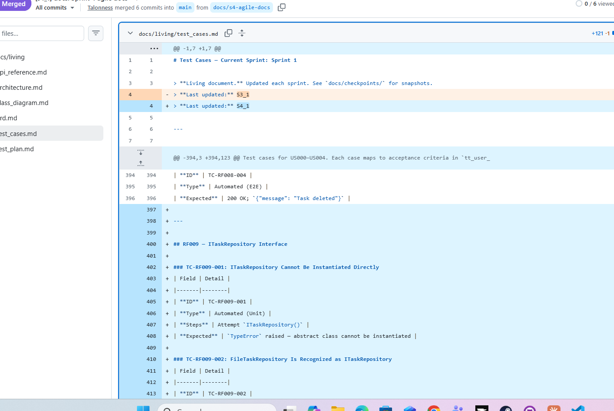
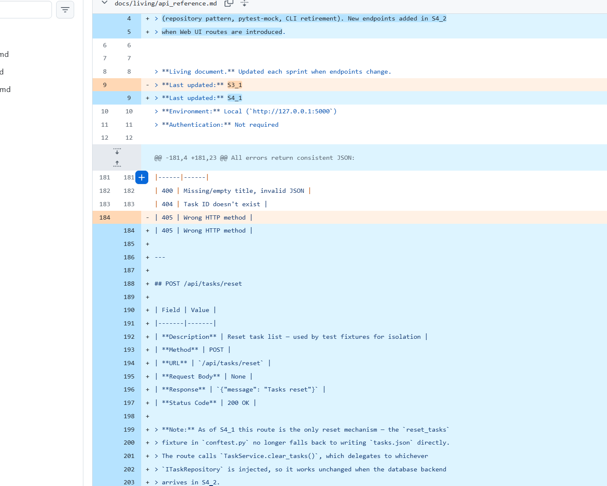
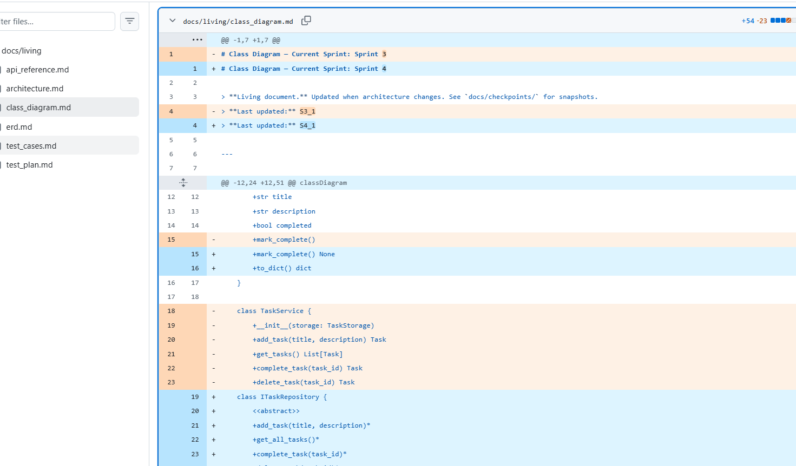
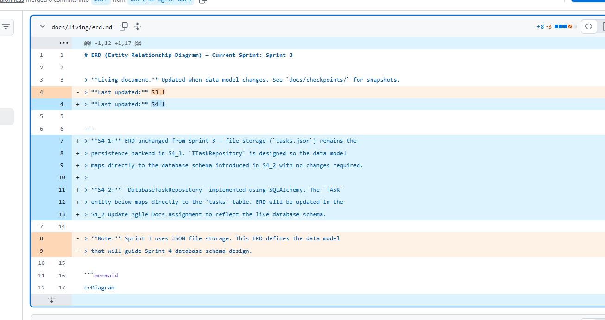

# S4_1 Agile Documentation — Screenshot Submission

**Student Name:**  
**Date:**  
**Assignment:** S4_1 Agile Documentation  
**Repository:** [paste your GitHub repo URL here]

---

## How to Use This Template

1. Create a folder named `images/s4` in your repository. This is where you'll save both this template and every screenshot for this assignment.
2. Save this file into `images/s4/` and rename: `lastname-S4_1-agile-docs.md`
3. Fill in name, date, and repo URL above
4. Take each screenshot and save it directly into `images/s4/`, using the exact filename shown below each placeholder (e.g., `sprint_plan.md.png`)
5. Embed each screenshot in the placeholder below it — since the template and screenshots live in the same folder, the image links already point to the right place
6. Export to PDF: right-click in VS Code → **Markdown PDF: Export (PDF)** — the PDF will save into `images/s4/` alongside the template and screenshots
7. Rename: `lastname-S4_1-agile-docs.pdf`
8. Submit to Blackboard → **S4_1 Agile Documentation**

> [!TIP]
> Keeping the template and screenshots in the same `images/s4/` folder means the image links in this file work without any changes. If you save a screenshot somewhere else, its embed will show as broken when you preview or export the file.

---

## Screenshot 1 — Sprint Plan PR

**What to capture:** `docs/s4-sprint-plan` PR → Files Changed → `sprint_plan.md` replaced with Sprint 4 content

**Save as:** `images/s4/sprint_plan.md.png`

**[Embed Screenshot 1 here]**

---

## Screenshot 2 — Architecture Diff

**What to capture:** `docs/s4-agile-docs` PR → Files Changed → `architecture.md`  
**Visible:** Repository pattern layered architecture; Sprint 3→4 changes table (incl. CI pipeline row); CLI retirement note; CI Pipeline section

**Save as:** `images/s4/architecture.md.png`

**[Embed Screenshot 2 here]**

---

## Screenshot 3 — Test Plan Diff

**What to capture:** Files Changed → `test_plan.md`  
**Visible:** OBJ-22 through OBJ-26a added; pytest-mock and GitHub Actions in tools table; CI Test Execution Strategy; RISK-CI-01 status Mitigated

**Save as:** `images/s4/test_plan.md.png`

**[Embed Screenshot 3 here]**

---

## Screenshot 3a — Test Plan Diff (continued, only if needed)

**What to capture:** The rest of the `test_plan.md` diff that didn't fit in Screenshot 3 — scroll down and capture from where Screenshot 3 ends

**Save as:** `images/s4/test_plan.md_3a.png`

> [!NOTE]
> **Only use this if the diff didn't fit in one screenshot.** If Screenshot 3 shows everything, delete this whole Screenshot 3a section before exporting to PDF.

**[Embed Screenshot 3a here]**

---

## Screenshot 4 — Test Cases Diff

**What to capture:** Files Changed → `test_cases.md`  
**Visible:** RF009, RF010, RF012, RF013 and SQA CI (TC-SQA-002–004) test case sections added

**Save as:** `images/s4/test_cases.md.png`

**[Embed Screenshot 4 here]**

---

## Screenshot 5 — API Reference Diff

**What to capture:** Files Changed → `api_reference.md`  
**Visible:** S4_1 note at top (no new endpoints in S4_1); `POST /api/tasks/reset` section with its note

**Save as:** `images/s4/api_reference.md.png`

**[Embed Screenshot 5 here]**

---

## Screenshot 6 — Class Diagram Diff

**What to capture:** Files Changed → `class_diagram.md`  
**Visible:** `ITaskRepository`, `FileTaskRepository`, `DatabaseTaskRepository` added; `MockTaskService` removal noted

**Save as:** `images/s4/class_diagram.md.png`

**[Embed Screenshot 6 here]**

---

## Screenshot 7 — ERD Diff

**What to capture:** Files Changed → `erd.md`  
**Visible:** S4_1 and S4_2 notes updated; database preview added

**Save as:** `images/s4/erd.md.png`

**[Embed Screenshot 7 here]**

---

## Submission Checklist

- [ ] `images/s4/` folder created, with this template and all screenshots saved inside it
- [ ] Screenshots 1–7 all embedded above (plus 3a only if the Test Plan diff needed two screenshots)
- [ ] PDF exported and renamed: `lastname-S4_1-agile-docs.pdf`

---

*Submitted for CSC 256 Software Quality Assurance — FA26*
