# S4_1 Lab Screenshots
## Sprint 4 Lab 1: Repository Pattern, pytest-mock, and CLI Retirement

**Student Name:** ___________________________

**Date:** ___________________________

**GitHub Repo URL:** ___________________________

---

> **Instructions:**
> 1. Save this file as `images/s4/lastname-S4_1-screenshots.md`
> 2. Replace each placeholder below with your actual screenshot
> 3. Export to PDF: right-click in VS Code → **Markdown PDF: Export (PDF)**
> 4. Rename: `lastname-S4_1-screenshots.pdf`
> 5. Submit to Blackboard **S4_1 Lab** assignment

---

## Screenshot 1 — S3_2 Baseline (All Tests Passing)

*Phase 1 Part 3 — Full test suite passing before S4_1 work begins. Server running in Terminal 1.*

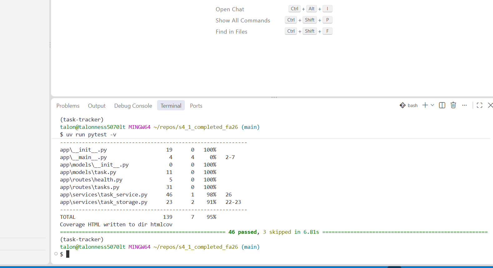

---

## Screenshot 1a — CI Runs Once Per PR

*Phase 1A Part 4 — Actions tab filtered to Python application, showing your `[s4_1] ci:` PR run at the top with no merge run after it.*

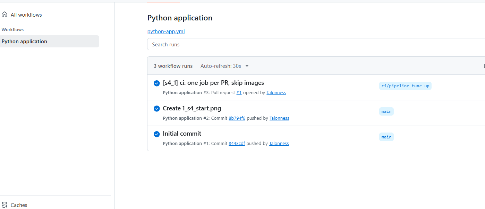

---

## Screenshot 1b — Single Job, Three Steps

*Phase 1A Part 4 — The single Lint, type-check, test job with its steps expanded and green.*

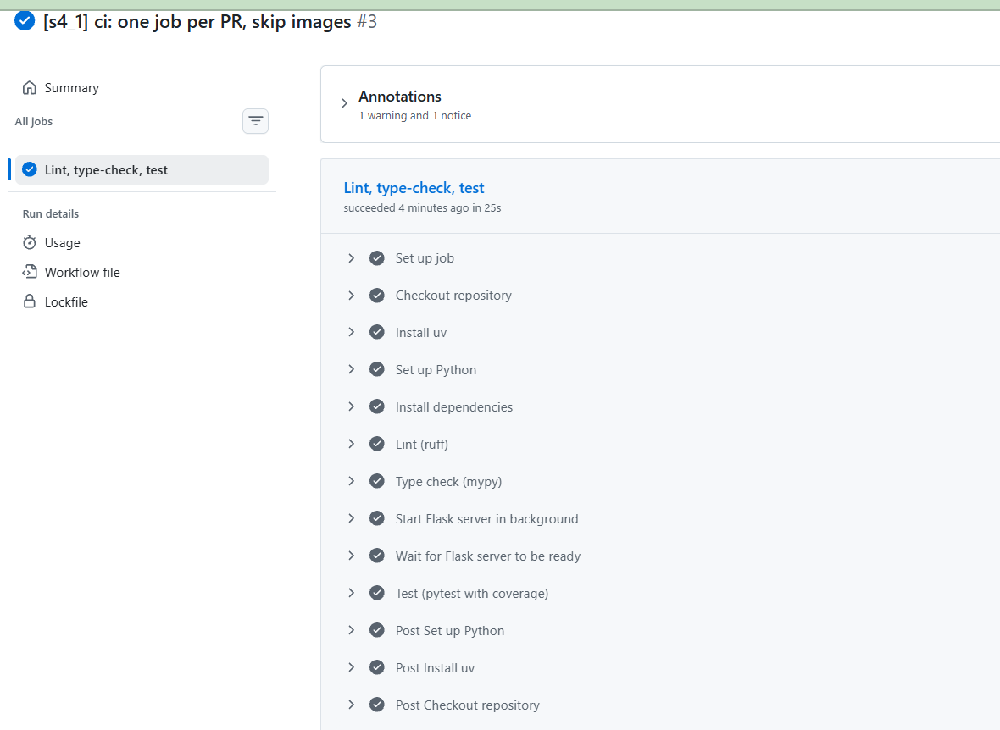

---

## Screenshot 2 — Contract Tests RED

*Phase 2 Part 2 — Contract tests in ERROR state. FileTaskRepository not yet implemented.*

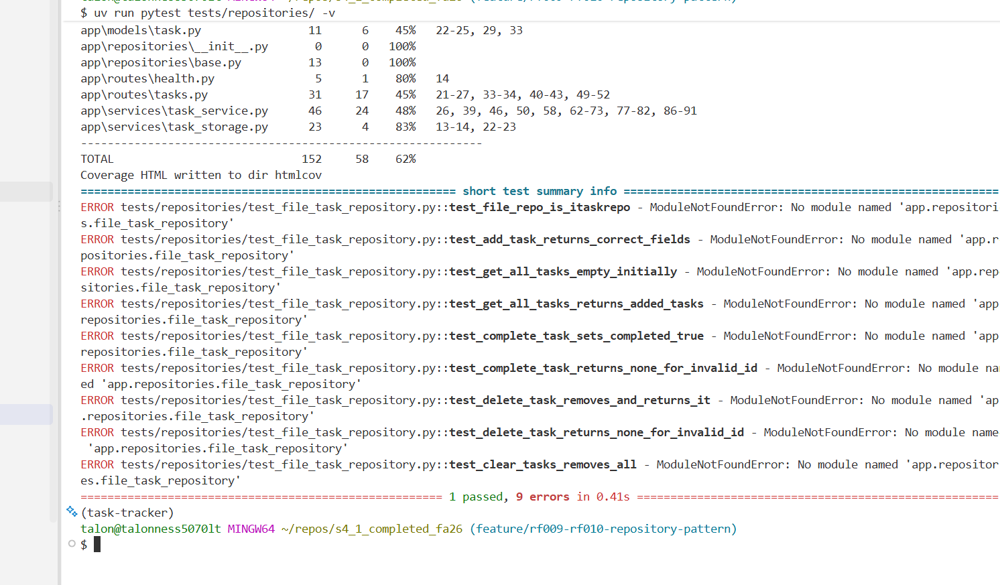

---

## Screenshot 3 — Contract Tests GREEN

*Phase 2 Part 3 — All FileTaskRepository contract tests passing after implementation.*

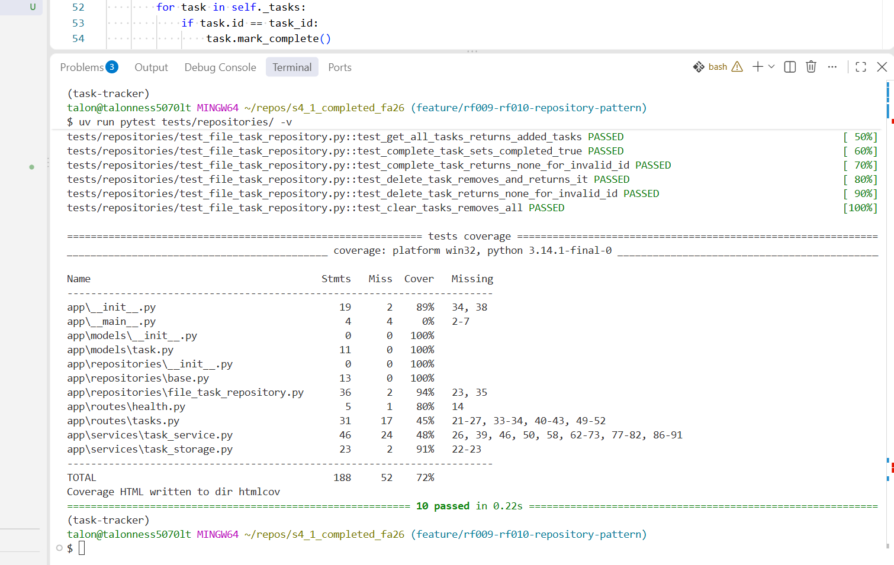

---

## Screenshot 4 — Full Suite Passing After Repository Refactor

*Phase 2 Part 8 — All tests passing after TaskService, create_app(), and all 7 service test files updated.*

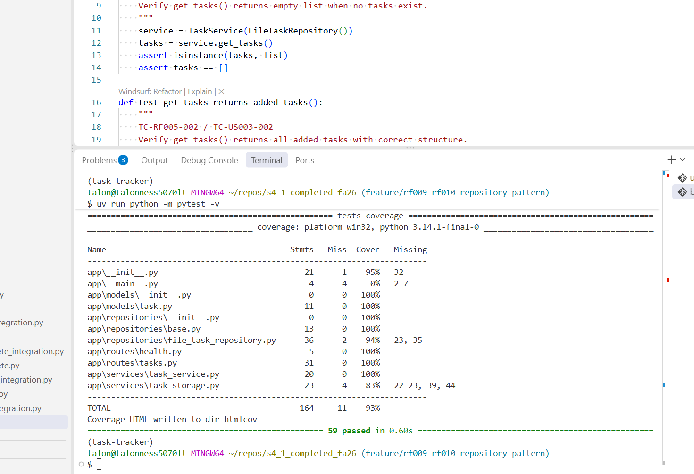

---

## Screenshot 5 — pytest-mock Route Tests Passing

*Phase 3 Part 1 — All 8 pytest-mock route tests passing in test_routes_with_mock.py.*

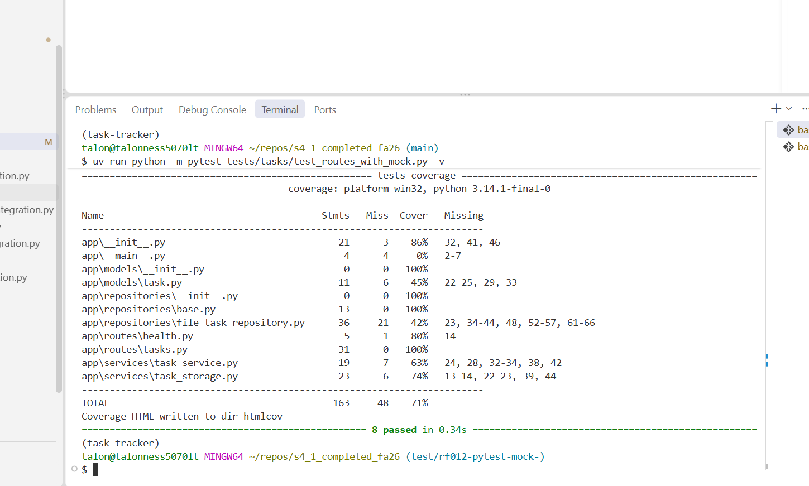

---

## Screenshot 6 — Full Suite After MockTaskService Removed

*Phase 3 Part 2 — All tests passing after MockTaskService removed from conftest.py.*

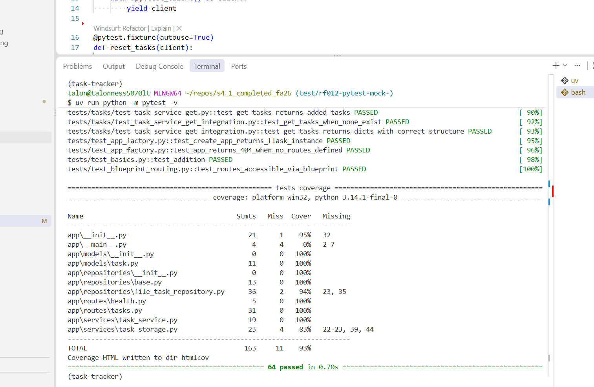

---

## Screenshot 7 — Full Suite After CLI Retired

*Phase 4 Part 3 — All tests passing after cli/ directory removed.*

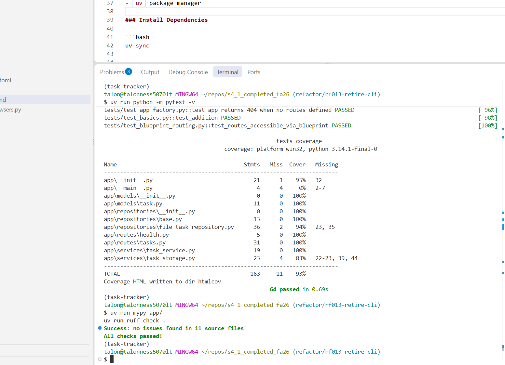

---

## Screenshot 8 — Full Test Suite with Coverage Terminal

*Phase 5 Part 1 — Full test suite with `--cov` coverage report in terminal.*

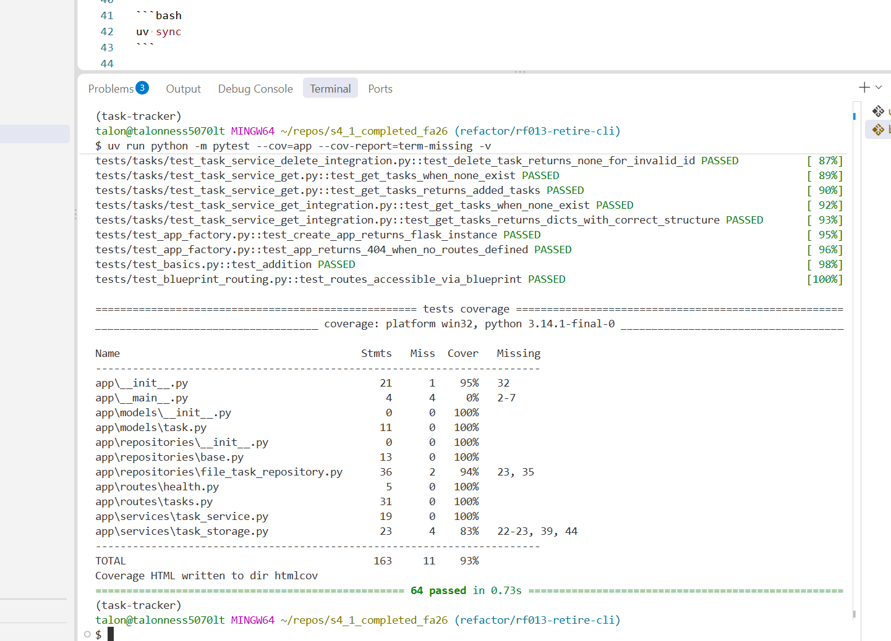

---

## Screenshot 9 — HTML Coverage Report

*Phase 5 Part 2 — HTML coverage report showing file breakdown in browser.*

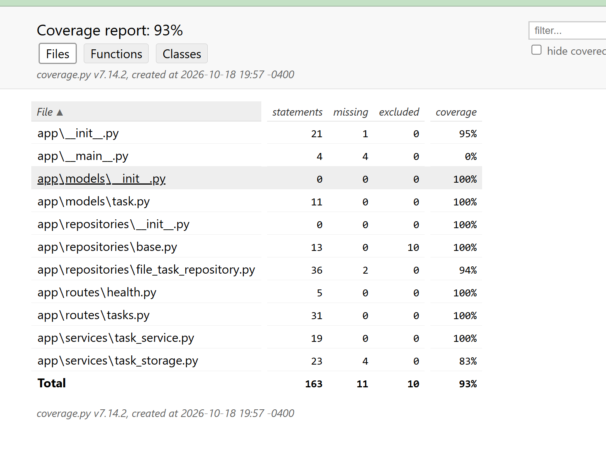

---

*End of S4_1 Lab Screenshots*
